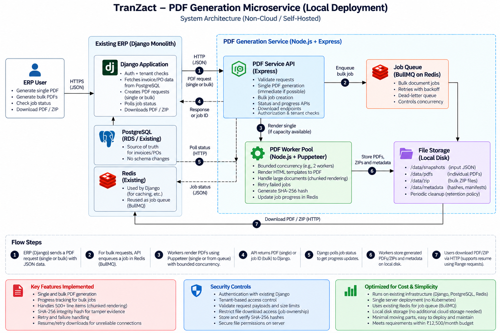

# ERP PDF Generation Microservice

A lightweight PDF-generation service for an existing ERP system. It converts invoice and purchase-order JSON into PDFs, supports asynchronous bulk generation, reports job progress, and packages bulk results into a downloadable ZIP archive.

This take-home prototype uses a deliberately small stack and keeps browser-based rendering outside the existing Django ERP process.

## Features

- Synchronous single-document PDF generation.
- Asynchronous bulk generation for 1–100 documents.
- Input validation before rendering or enqueueing a bulk job.
- Redis and BullMQ queue with retries and exponential backoff.
- Bounded Puppeteer rendering concurrency and timeouts.
- Bulk job status and progress polling.
- ZIP output containing successfully generated PDFs and `manifest.json`.
- SHA-256 metadata for generated PDFs.
- Local filesystem artifact storage for development.

## Technology Stack

- Node.js 20+
- Express
- Puppeteer
- Redis, BullMQ, and ioredis
- Archiver
- Node.js built-in test runner

## Architecture



The current prototype uses local filesystem storage. Amazon S3 storage, authentication, tenant-level authorization, and production monitoring are proposed production improvements, not features demonstrated by the local prototype.

## How It Works

1. A client submits one document or a bulk request to the Express API.
2. The API validates the input.
3. A single document is rendered synchronously. Bulk requests are snapshotted and queued in Redis/BullMQ.
4. A worker renders documents with Puppeteer and HTML templates, subject to bounded concurrency.
5. Bulk results are packaged into a ZIP with `manifest.json`, including per-document outcomes and SHA-256 hashes for successful PDFs.
6. The client polls job status and downloads the completed artifact.

## Requirements

- Node.js 20 or newer
- npm
- Docker Desktop with Docker Compose, or a local Redis instance

## Setup

### 1. Install Dependencies

Run from the project root:

```bash
npm install
```

Puppeteer needs a compatible Chromium browser. Allow its browser installation to complete and ensure the runtime environment supports Chromium.

### 2. Start Redis

If the repository includes a Docker Compose Redis service:

```bash
docker compose up -d redis
```

If the Compose service has a different name, use the name defined in `docker-compose.yml` or `compose.yaml`.

Check Redis connectivity:

```bash
docker exec -it pdf-service-redis redis-cli ping
```

Expected output:

```text
PONG
```

### 3. Configure Environment Variables

Defaults used for local development:

| Variable          | Default                                               | Purpose                                    |
| ----------------- | ----------------------------------------------------- | ------------------------------------------ |
| `PORT`            | `3000`                                                | HTTP server port                           |
| `REDIS_URL`       | `redis://127.0.0.1:6379`                              | Redis connection URL                       |
| `STORAGE_DIR`     | `../storage` relative to the service source directory | Directory for generated artifacts          |
| `BULK_WORKERS`    | `2`                                                   | Concurrent bulk jobs handled by the worker |
| `PDF_CONCURRENCY` | `2`                                                   | Maximum simultaneous PDF renders           |

Set environment variables in your shell before starting the service if you need different values. Do not commit credentials or environment-specific secrets.

The concurrency defaults are conservative development settings, not evidence that the service meets the assignment's peak throughput. Measure CPU, memory, render duration, queue wait, and failure rate before changing them.

### 4. Start the API

Development mode:

```bash
npm run dev
```

Or start normally:

```bash
npm start
```

Default base URL: `http://localhost:3000`

Check service health in PowerShell:

```powershell
Invoke-RestMethod http://localhost:3000/health
```

A healthy local service should report an `ok` status and a ready queue.

## API Overview

| Method | Endpoint              | Purpose                         |
| ------ | --------------------- | ------------------------------- |
| `GET`  | `/health`             | Health and queue readiness      |
| `POST` | `/v1/documents`       | Generate one PDF synchronously  |
| `POST` | `/v1/bulk-jobs`       | Validate and enqueue a bulk job |
| `GET`  | `/v1/bulk-jobs/:id`   | Read job status and progress    |
| `GET`  | `/v1/artifacts/:name` | Download a generated artifact   |

Use the schema accepted by the validation module and HTML templates in the submitted code revision. Examples below assume valid JSON files have already been prepared.

### Generate a Single PDF

Send one supported invoice or purchase-order JSON document:

```http
POST /v1/documents
Content-Type: application/json
```

The endpoint returns PDF bytes when rendering succeeds and includes an `X-Content-SHA256` response header.

PowerShell example, using a valid `single.json`:

```powershell
$response = Invoke-WebRequest `
  -Uri http://localhost:3000/v1/documents `
  -Method POST `
  -ContentType "application/json" `
  -InFile .\single.json `
  -OutFile .\single.pdf

$response.StatusCode
Get-Item .\single.pdf
$response.Headers["X-Content-SHA256"]
```

### Submit a Bulk Job

The bulk endpoint accepts a JSON object with a `documents` array containing 1–100 supported documents.

```http
POST /v1/bulk-jobs
Content-Type: application/json
```

PowerShell example, using a valid `bulk.json`:

```powershell
$job = Invoke-RestMethod `
  -Uri http://localhost:3000/v1/bulk-jobs `
  -Method POST `
  -ContentType "application/json" `
  -InFile .\bulk.json

$job
```

Save the returned job ID. Invalid batches are rejected before processing; for example, an empty `documents` array returns HTTP 400.

### Check Progress

Replace `<job-id>` with the ID returned by the bulk endpoint:

```powershell
Invoke-RestMethod http://localhost:3000/v1/bulk-jobs/<job-id>
```

The response reports job state and progress, including document totals and success/failure counts when available. Poll periodically rather than in a tight loop.

### Download the ZIP Artifact

When the status response includes a `downloadUrl`, download the generated artifact:

```powershell
Invoke-WebRequest `
  -Uri "http://localhost:3000/v1/artifacts/<job-id>.zip" `
  -OutFile .\bulk-output.zip
```

Use the actual artifact name or URL returned by the API. A completed bulk ZIP contains successfully generated PDFs and a `manifest.json` describing document outcomes and hashes.

## Validation and Error Handling

- Document types and field rules are enforced by the validation module.
- Invalid bulk payloads are rejected before queueing.
- A per-document rendering failure is recorded in the manifest while processing can continue for other documents.
- Fatal job-level errors can trigger BullMQ retries according to the configured attempt and backoff policy.
- Rendering concurrency and timeouts are bounded.
- Temporary bulk work files are cleaned up after processing.

A retry can repeat work completed before a fatal failure if the job is not made fully idempotent. Idempotency keys, atomic state transitions, and robust partial-artifact recovery remain production hardening tasks.

## Tests

Run the automated suite:

```bash
npm test
```

The tests use Node.js's built-in test runner and cover validation, HTML escaping/template behavior, large line-item template construction, and BullMQ retry behavior.

Record the exact pass/fail count from `npm test` on the same code revision you submit. A BullMQ retry test validates queue retry mechanics in isolation; it is not an end-to-end test of a real PDF-render failure and artifact recovery.

### Local Verification Observed During Development

- `/health` reported an `ok` status and a ready queue.
- Empty and malformed bulk requests returned HTTP 400.
- A small invoice rendered successfully.
- A 600-line-item invoice eventually rendered in about 5.13 seconds and produced an 889,418-byte PDF. An earlier attempt encountered a Chromium connection-closed error, so repeated stress testing and root-cause investigation remain necessary.
- A 50-document bulk job completed with 50 PDFs and a manifest.
- A 100-document bulk job completed with 100 PDFs and a manifest.

These are local functional checks, not a production load test. They do not prove target peak throughput, production reliability, or that the full service fits the monthly AWS budget.

## Storage and Deployment Limitations

The prototype stores PDFs and ZIPs on local disk. This is suitable for local evaluation but:

- Artifacts are tied to the host filesystem and are not automatically shared across instances.
- Files can be lost if the host or storage volume is lost.
- Download resumption over unreliable networks has not been established.
- Retention and cleanup need operational controls.
- Local storage does not provide tenant-aware authorization by itself.

For production, use private object storage such as Amazon S3 with authorization, lifecycle rules, encryption, and a deliberate retention policy. Test HTTP Range/resume behavior with the chosen download path before promising resumable downloads.

## Security and Production Readiness

This is a prototype, not a production-ready compliance service. Before production use, address:

- Service-to-service authentication and tenant-level authorization for jobs, PDFs, ZIPs, and manifests.
- Authorization checks on every artifact download. An artifact ID alone must not grant access.
- A consistent, versioned ERP snapshot for each bulk request.
- Idempotency keys and safe retry behavior.
- Durable artifact storage, retention, cleanup, and host-restart recovery.
- Protected integrity records. SHA-256 can reveal byte changes only when the expected digest is stored somewhere trustworthy; a hash alone is not tamper-proof compliance evidence.
- Structured logs, metrics, alerts, queue-age monitoring, and dashboards.
- Load tests with realistic documents and concurrent single/bulk traffic.
- A complete AWS estimate including storage retention, data transfer, queue hosting, logs, monitoring, backups, and taxes.

See `APPROACH.md` for assumptions, capacity calculations, design trade-offs, limitations, and cost-estimation assumptions.

## Project Structure

```text
.
├── src/
│   ├── server.js       # Express routes, queue, worker, artifact handling
│   ├── pdf.js          # Puppeteer rendering and concurrency limit
│   ├── template.js     # Invoice and purchase-order HTML templates
│   └── ...             # Validation and supporting modules
├── tests/              # Automated tests
├── architecture.png    # Architecture diagram
├── APPROACH.md         # Design submission
├── COST-ESTIMATE.md    # Cost assumptions, if included
├── package.json
└── README.md
```

Use the actual repository contents as the source of truth if filenames differ by revision.

## Submission Artifacts

- `README.md` — setup, API usage, testing, and limitations.
- `APPROACH.md` — assumptions, capacity math, design decisions, AI usage, weaknesses, and cost discussion.
- `architecture.png` — diagram distinguishing the implemented prototype from proposed production components.
- `COST-ESTIMATE.md` and the AWS Pricing Calculator export, if included — estimate and exclusions.

## License

Prepared as a take-home assignment prototype. No separate open-source license is specified.
